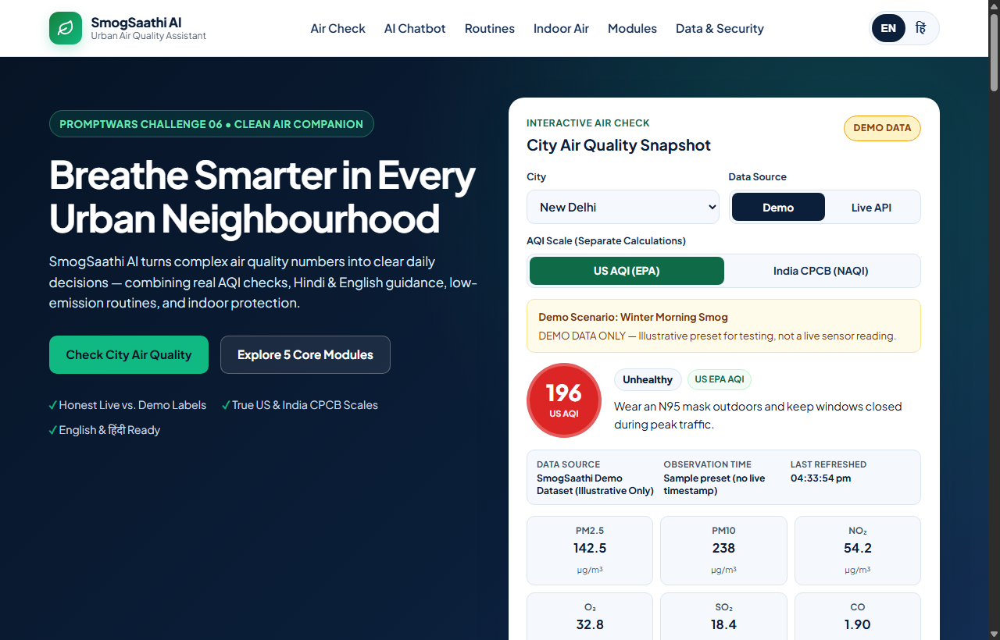
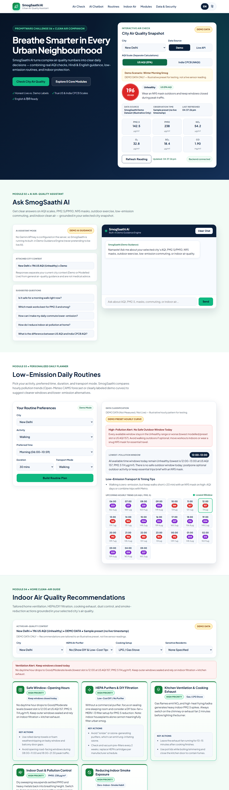

# SmogSaathi AI (स्मॉगसाथी AI)

**SmogSaathi AI** is a responsive, bilingual (**English & Hindi**) Urban Air Quality Assistant built for **PromptWars Challenge 06**. It turns complex urban pollution metrics into practical daily health, commuting, and indoor clean-air decisions—with strict separation between **Demo presets**, **Live Open-Meteo CAMS modelled estimates**, and **official CPCB ground-station telemetry**.

---

## Screenshots

### Desktop — Interactive Air Check (`US AQI` & `India CPCB NAQI`)


### Desktop — Full Application Overview (Modules 01–05)


---

## Core Features

1. **Air Quality Dashboard (`#aqi-checker`)**
   - Supports 5 Indian urban centers: **New Delhi**, **Mumbai**, **Bengaluru**, **Lucknow**, and **Kanpur**.
   - **Explicit Scale Selector:** Switch independently between **US AQI (EPA)** and **India CPCB (NAQI)**. US AQI is never presented as CPCB AQI.
   - **Official India CPCB Calculation:** Computes pollutant sub-indices across `PM2.5`, `PM10`, `NO₂`, `O₃`, `SO₂`, and `CO` (`µg/m³` → `mg/m³`) using CPCB linear-interpolation breakpoints, trailing 24h/8h hourly averages in Live mode, dominant pollutant identification, and CPCB's minimum 3-pollutant + particulate rule.
   - **Clear Data Labeling:** Displays `DEMO DATA` vs. `LIVE API`, provider name, observation timestamp, and last-refreshed time, plus loading, success, and error/fallback states.

2. **AI Air-Quality Chatbot (`#chatbot`)**
   - Answers questions about AQI scales, `PM2.5`/`PM10`, `N95` masks, outdoor exercise, low-emission commuting, and indoor air quality in **English** and **Hindi**.
   - Attaches your currently selected city, AQI score, scale, and Demo/Live context automatically.
   - **Secure Server-Side Integration:** Calls Gemini via `POST /api/chat` using `GEMINI_API_KEY` stored only in `.env` (`x-goog-api-key` header).
   - **Honest Demo Fallback:** When `GEMINI_API_KEY` is not configured, runs the clearly badged **Built-in Demo Guidance Engine** (`DEMO AI GUIDANCE`) rather than pretending live AI is connected.

3. **Personalized Low-Emission Daily Routines (`#routines`)**
   - Linked to your selected city and data mode (`Demo` / `Live API`).
   - Evaluates upcoming 24-hour pollution curves across 6 activities (`Walking`, `Jogging`, `School Commute`, `Office Commute`, `Cycling`, `Daily Errands`), 5 preferred time windows, 5 durations, and 5 transport modes.
   - Explains why a suggested window is cleaner (including `%` `PM2.5` reduction), offers practical low-emission transport alternatives, and issues a clear **No Safe Outdoor Window Today** alert whenever all available windows are unhealthy.

4. **Indoor Air Quality Recommendations (`#indoor`)**
   - Personalizes guidance based on your city's current AQI + upcoming hourly forecast, `HEPA Air Purifier` availability, `Cooking Setup` (`LPG/Gas` vs. `Electric/Induction`), and `Sensitive Residents`.
   - Covers 5 core cards: **Safe Window-Opening Hours**, **HEPA Purifiers & DIY Filtration**, **Kitchen Ventilation & Cooking Exhaust**, **Indoor Dust & Pollution Control**, and **Reducing Indoor Smoke Exposure**.
   - Includes a 6-item interactive clean-air checklist with a progress bar, `Pending`/`Done` tags, `localStorage` persistence, and `Reset` control.

5. **English & Hindi Bilingual Support (`EN / हिं`)**
   - Instant client-side language switching across all navigation items, forms, badges, warnings, chatbot responses, routines, indoor cards, and checklists.

---

## System Architecture

```text
SmogSaathi-AI/
├── .env.example                 # Environment template (never commit .env)
├── .gitignore                   # Ignores .env, node_modules, logs
├── .dockerignore                # Excludes dev/test files from Docker image
├── .github/workflows/ci.yml     # GitHub Actions CI (syntax check + 22 tests)
├── Dockerfile                   # Zero-dependency Node 24 Alpine container
├── render.yaml                  # One-click Render Web Service blueprint
├── package.json                 # Scripts: start, dev, check, build, test
├── server.js                    # Node.js HTTP server, static security & API routes
├── docs/screenshots/            # Verified desktop & mobile screenshots
├── src/
│   ├── config/env.js            # Safe .env loader & sanitized server config
│   ├── data/demoAqi.js          # Clearly labeled Demo presets & hourly curves
│   └── services/
│       ├── aqiService.js        # Open-Meteo API client & Demo/Live coordinator
│       ├── cpcbAqi.js           # Official India CPCB NAQI breakpoint engine
│       ├── chatService.js       # Gemini proxy + Demo Guidance Engine
│       ├── routineService.js    # Hourly window scorer & transport advisor
│       └── indoorService.js     # Indoor ventilation, cards & checklist engine
├── public/                      # Frontend (vanilla HTML, CSS, ES Modules)
│   ├── index.html
│   ├── css/styles.css           # Green, White & Navy responsive design system
│   └── js/
│       ├── i18n.js              # English & Hindi dictionary
│       └── app.js               # State management, API calls & UI rendering
└── tests/
    ├── cpcbAqi.test.js          # CPCB formula & minimum pollutant rule tests
    ├── chatService.test.js      # Bilingual chatbot & Gemini key security tests
    ├── routineService.test.js   # Routine window ranking & unhealthy warning tests
    ├── indoorService.test.js    # Ventilation schedule & indoor card tests
    └── server.test.js           # HTTP API, security headers & traversal tests
```

- **Zero External npm Dependencies:** Built purely on Node.js (`>=20`, verified on Node `v24.20.0`) built-in modules (`node:http`, `node:fs`, `node:path`, `node:test`) and standard browser ES Modules—fast to install, easy to audit, and zero dependency-supply-chain bloat.

---

## Local Setup & Environment Variables

### Prerequisites
- **Node.js 20+** (tested on **Node.js v24.20.0**)

### Steps
1. Clone the repository and open the folder:
   ```bash
   git clone <your-repo-url>
   cd SmogSaathi-AI
   ```
2. *(Optional)* Configure environment variables by copying `.env.example` to `.env`:
   ```bash
   cp .env.example .env
   ```
   | Variable | Default | Description |
   | :--- | :--- | :--- |
   | `PORT` | `3000` | HTTP port (`process.env.PORT` used automatically by cloud hosts) |
   | `HOST` | `0.0.0.0` | Network interface to bind |
   | `DEFAULT_AQI_MODE` | `demo` | Initial dashboard mode (`demo` or `live`) |
   | `GEMINI_API_KEY` | *(empty)* | Optional Google Gemini API key (stays strictly on the server) |
   | `GEMINI_MODEL` | `gemini-2.5-flash` | Gemini model ID used when `GEMINI_API_KEY` is set |

3. Start the application:
   ```bash
   npm start
   ```
4. Open **http://localhost:3000** in your browser.

---

## API Reference

| Endpoint | Method | Purpose |
| :--- | :---: | :--- |
| `/api/health` | `GET` / `HEAD` | Service readiness, default mode, and `aiConfigured` boolean (never leaks keys) |
| `/api/cities` | `GET` | Supported cities with coordinates and bilingual names |
| `/api/aqi?city=delhi&mode=demo\|live&scale=us\|cpcb` | `GET` | Current AQI report with separate US EPA & India CPCB calculations |
| `/api/chat` | `POST` | Server-side AI / Demo Guidance chatbot with attached `aqiContext` |
| `/api/routine` | `POST` | 24-hour window analysis, safety warning, and low-emission transport tips |
| `/api/indoor` | `POST` | Safe window-opening schedule, 5 indoor cards, and 6-item checklist |

---

## Verification & Testing

Run syntax verification ("production build check") and the full automated suite:
```bash
npm run build
npm test
```
- `npm run build` / `npm run check`: runs `node --check` on `server.js`, all `src/**/*.js`, and all `public/js/**/*.js`.
- `npm test`: runs `node --test tests/*.test.js` (**22/22 tests passing** across CPCB math, Chatbot, Routines, Indoor, and HTTP/security tests).

---

## GitHub & Public Deployment

This repository is ready to push to GitHub and deploy publicly:

1. **GitHub Push (verify `.env` is ignored first):**
   ```bash
   git status
   git add .
   git commit -m "Initial SmogSaathi AI release for PromptWars Challenge 06"
   git remote add origin <your-github-repo-url>
   git push -u origin main
   ```
   GitHub Actions CI (`.github/workflows/ci.yml`) automatically runs `npm run check` and `npm test` on Node 20, 22, and 24.

2. **Deploy to Render (using included `render.yaml`):**
   - Connect your GitHub repo in Render → **New Blueprint** (reads `render.yaml`), or create a Web Service with Build Command `npm run build`, Start Command `npm start`, Health Check `/api/health`, and optionally set `GEMINI_API_KEY` in Render's secret Environment settings.

3. **Deploy via Docker (Railway / Fly.io / Cloud Run / VPS):**
   ```bash
   docker build -t smogsaathi-ai .
   docker run -p 3000:3000 -e DEFAULT_AQI_MODE=live smogsaathi-ai
   ```

---

## Technical Limitations & Data Integrity Notes

- **Modelled Estimates vs. CPCB Ground Stations:** Live air-quality readings and 24-hour hourly curves come from the **Open-Meteo Air Quality API** (powered by the **CAMS** global atmospheric model, ~10–40 km grid resolution), **not** physical CPCB CAAQMS street-level monitors. Hyper-local roadside spikes may differ.
- **CPCB Pollutant Coverage:** Open-Meteo provides 6 of the 8 CPCB NAQI pollutants (`PM2.5`, `PM10`, `NO₂`, `O₃`, `SO₂`, `CO`). `NH₃` (Ammonia) and `Pb` (Lead) are unavailable from Open-Meteo; CPCB's `>= 3` pollutants + `PM2.5/PM10` validity rule is still satisfied.
- **Hourly Routine Timeline Units:** Because official India CPCB NAQI is defined over 24h/8h rolling averages, the hourly routine planner compares hourly `US AQI` and `PM2.5` (`µg/m³`) rather than inventing 1-hour CPCB indices.
- **Demo Presets & Demo AI:** Demo AQI presets and the Built-in Demo Guidance Engine (used when `GEMINI_API_KEY` is unset) are strictly illustrative and prominently labeled `DEMO` throughout the UI.
- **General Guidance Disclaimer:** Health, mask, and indoor recommendations follow general clean-air hygiene practices and are **not** medical advice or diagnosis.
